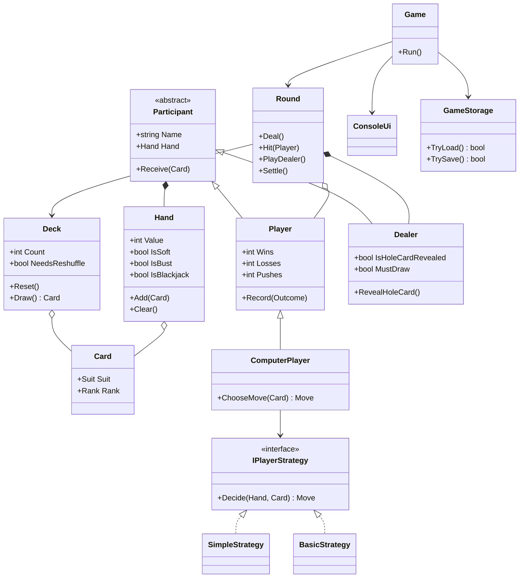

# Tjugoett

Ett spelbart tjugoett (blackjack) i konsolen för en till fem spelare mot en given. Skrivet i C# (.NET).

## Starta

```
dotnet run
```

Spelarnas resultat (vunna, förlorade och lika rundor) sparas i `players.json` bredvid programmet och läses in vid nästa start.

## Regler

- Mål: komma närmare 21 än givaren utan att spräcka.
- Ess räknas som 1 eller 11, kort 2-10 sitt värde, klädda kort 10.
- Varje spelare får två kort. Givaren får ett öppet kort och ett hålkort.
- Spelaren väljer att köpa ett kort eller stanna. Över 21 är spräckt.
- Givaren köper på 16 eller lägre och stannar på 17 eller högre, även mjuk 17.
- Naturlig tjugoett (ess + tiokort) slår en 21 av tre kort eller fler. Lika värde är lika.
- En kortlek om 52 kort. Vid färre än 15 kort kvar blandas en ny lek inför nästa runda (Fisher-Yates).

## Tillval 2: datorspelare med strategi

Datorspelare kan sitta vid bordet tillsammans med människor. De följer en strategi via gränssnittet `IPlayerStrategy`:

- `SimpleStrategy`: köp så länge handen är under 17.
- `BasicStrategy`: slår upp köp/stanna i en grundstrategitabell utifrån handens värde, om den är mjuk eller hård, och givarens öppna kort.

## Struktur

Regelklasserna (`Card`, `Deck`, `Hand`, `Participant`, `Player`, `Dealer`, `Round`) skriver och läser aldrig något. All in- och utmatning ligger i `ConsoleUi`.

| Klass | Ansvar |
|---|---|
| `Suit`, `Rank` | Färg och valör |
| `Card` | Ett kort, utan fast värde (esset har två) |
| `Deck` | Bygger, blandar och drar kort, blandar om vid färre än 15 kvar |
| `Hand` | Räknar värde, mjuk/hård, spräckt, naturlig tjugoett |
| `Participant` | Basklass med namn och hand |
| `Player` | Spelare med vunna, förlorade och lika rundor |
| `Dealer` | Hålkort och givarens fasta regel |
| `ComputerPlayer` | Spelare som låter en strategi välja drag |
| `Round` | Dela ut, köp, givarens tur, avgörande |
| `Game` | Meny och spelloop |
| `GameStorage` | Läser och skriver spelare till JSON |
| `ConsoleUi` | All in- och utmatning |

## Klassdiagram



## Git

`main` är stabil, `dev` är integrationsbranch och varje del byggdes på en egen feature-branch (`feature-card-deck`, `feature-hand`, `feature-game-logic`, `feature-spec-alignment`, `feature-game-loop`, `feature-computer-player`).